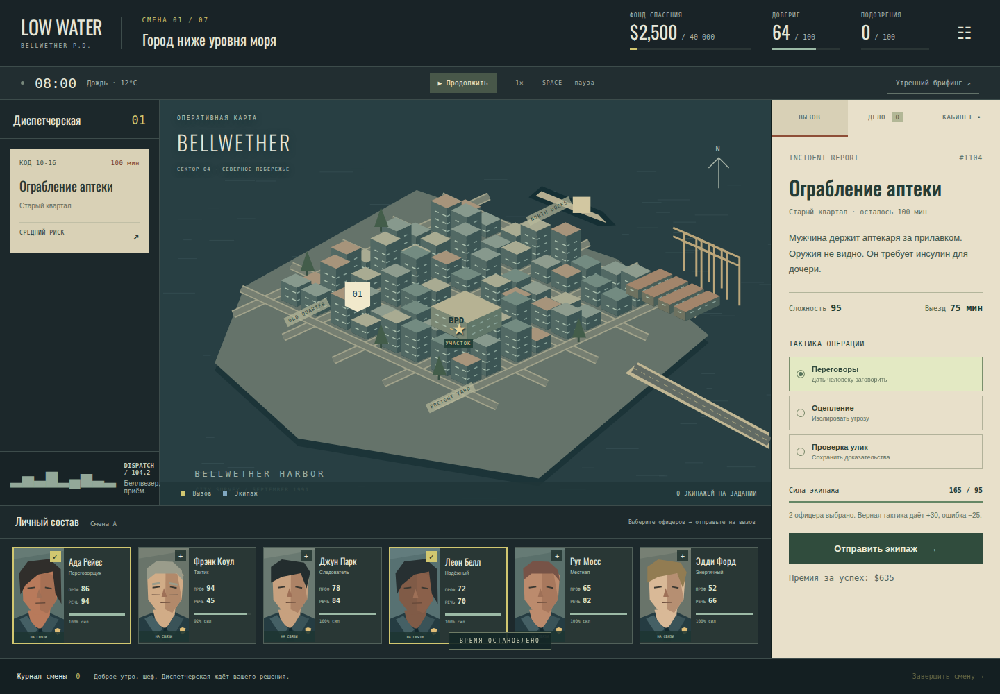

# LOW WATER / Низкая вода

Авторская браузерная полицейская стратегия по мотивам механик **This Is the Police**. Самостоятельная история, персонажи, музыка и угловатая векторная графика.



Беллвезер, сентябрь 1991-го. Начальник полиции Мара Вейл должна собрать **$40 000 за семь смен**, чтобы вывезти брата, ставшего свидетелем коррупционной сделки по продаже порта.

## Играть

[Открыть игру](https://raw.githack.com/Khakimovpro/this_is_police/main/play/index.html) · [Вступительный ролик](https://raw.githubusercontent.com/Khakimovpro/this_is_police/main/public/assets/prologue.mp4)

При первом открытии ссылки нажмите **Open the page** на странице сервиса просмотра GitHub-файлов.

Игра работает в современном браузере. После загрузки не обращается к нейросетям и не требует ключей. Сохранение хранится в вашем браузере. При переходе на другой адрес сайта оно не переносится автоматически.

## Что внутри

- Семь смен, 35 сюжетных вызовов и шесть полицейских с разными навыками и усталостью.
- Отправка экипажей, ограниченное время на вызов, выбор тактики, возвращение сотрудников.
- Расследование продажи порта: сбор улик, проверка счетов, выбор подозреваемого и ордер.
- Законные контракты, премии, зарплата и сомнительные предложения начальнику.
- Доверие города, подозрения внутренней безопасности и четыре основных финала.
- Вступление на 55,58 секунды, 17 озвученных реплик на английском и русские субтитры.
- Два оригинальных джазовых трека, звуки интерфейса, радио и сирена.
- Автосохранение, пауза, ускорение времени и отдельные настройки музыки, голосов и эффектов.

Это законченная короткая кампания примерно на 20–40 минут с учётом чтения и пауз. Вызовы и улики написаны заранее; тактические результаты определяются навыками, усталостью и выбранным решением.

## Как играть

1. Выберите вызов слева или на карте.
2. Отметьте от одного до трёх свободных офицеров внизу.
3. Прочтите обстоятельства, выберите переговоры, оцепление или проверку улик.
4. Отправьте экипаж. Верная тактика прибавляет 30 к силе, ошибка отнимает 25.
5. Следите за новыми вызовами и силами сотрудников. Пропущенный вызов снижает доверие.
6. Во вкладке **Дело** соберите четыре улики и сопоставьте их с подозреваемыми. Ошибочный ордер закрывает расследование.
7. В **Кабинете** берите законные контракты или принимайте личные предложения. Для контракта нужен один свободный офицер.
8. В конце смены дождитесь экипажей и нажмите **Завершить смену**. Офицеры восстановят 45 пунктов сил.

**Пробел** — пауза; **1–6** — выбор офицеров; **Esc** — закрыть документ. При открытии документов и смене вкладки браузера часы останавливаются. После отправки экипажа время продолжает идти.

## Запуск локально

Нужен Node.js 22.12+.

```bash
npm ci
npm run dev
```

Открыть адрес, который напечатает Vite. Сервер слушает только `127.0.0.1`.

```bash
npm test
npm run build
npm run preview
```

Для браузерной проверки запустите игру на порту 4319:

```bash
npm run dev -- --port 4319
# В другом терминале:
npx playwright install chromium
npm run test:browser
```

## Материалы и устройство

[Сюжет и финалы](docs/story.md) · [Источники графики и звука](CREDITS.md) · [Устройство проекта](docs/architecture.md) · [Отчёт с измерениями](work/initial-release/report.md).

Исходник ролика — `videos/prologue/`. Готовый ролик — `public/assets/prologue.mp4`. Сборка для просмотра через GitHub CDN — `play/`.

Генератор аудио запускается отдельно и может расходовать баланс Polza. Для его использования сохраните ключ в локальном `.env` по примеру `.env.example`; в браузер ключ никогда не передаётся. Уже полученные файлы включены в репозиторий, повторная генерация для игры не нужна.

```bash
python3 -m pip install -r scripts/requirements-media.txt
python3 scripts/generate_audio.py --env-file .env
```

В каталоге игры нет графики, музыки, диалогов или персонажей из оригинальной This Is the Police. LOW WATER не связана с её разработчиками.
